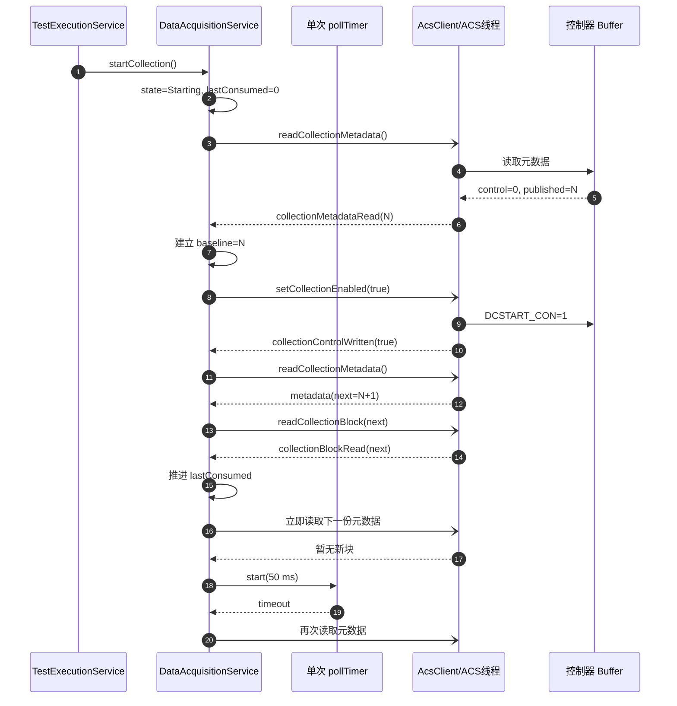
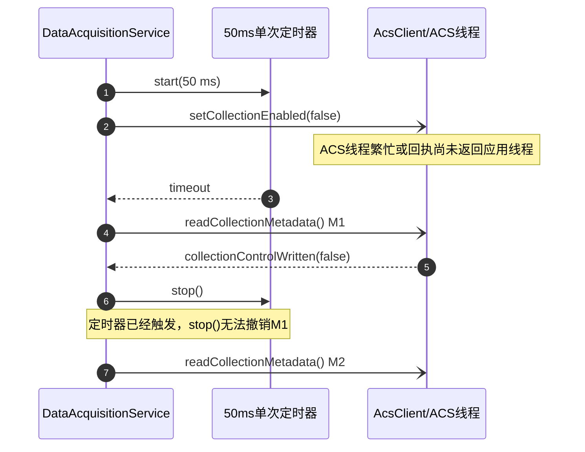
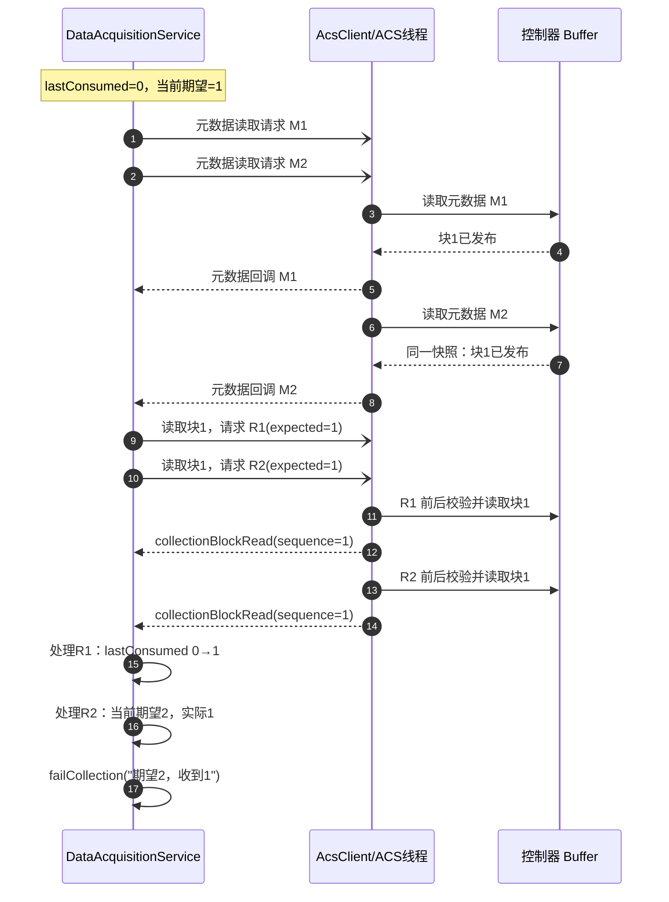
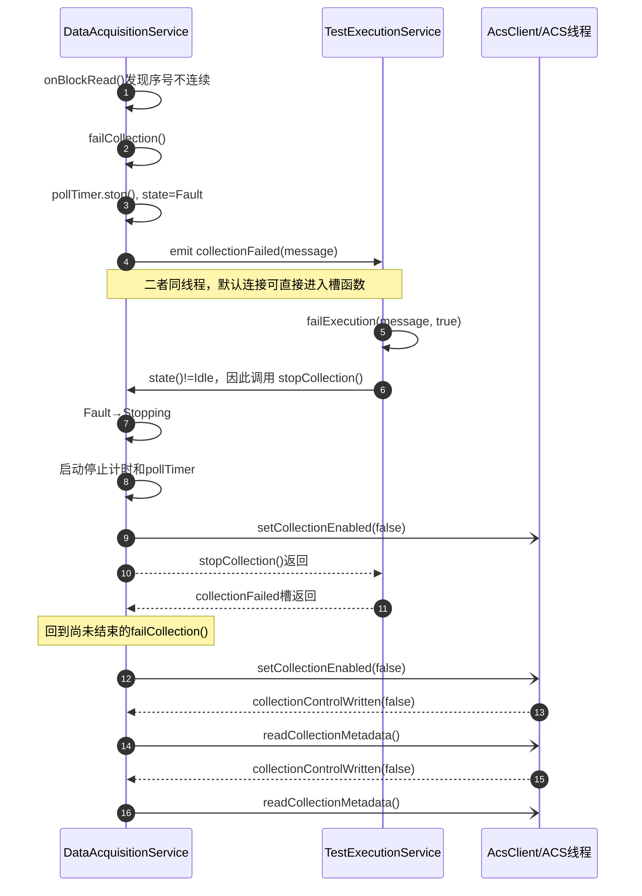
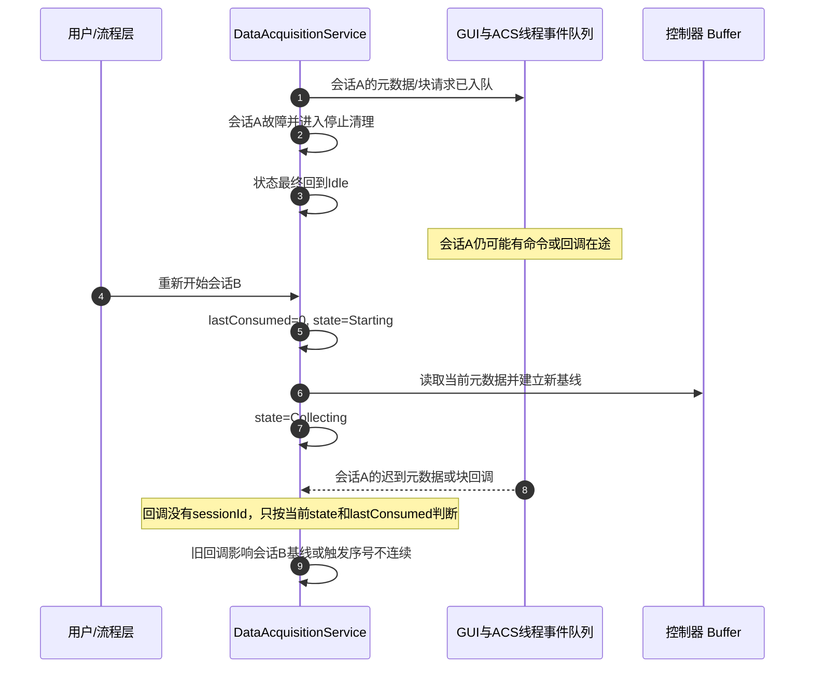

# 采集序号不连续、故障停止重入及重新开始仍异常

## 问题现象

测试运行中偶发以下问题：

1. 软件报告采集块序号不连续，例如“期望 2，收到 1”。
2. 第一次故障发生后，故障处理存在明显的重入停止路径。
3. 不退出软件直接重新开始测试时仍会异常；复位采集 Buffer 后仍可能异常；退出并重新启动软件后恢复。

补充观察：软件重启前后曾看到控制器侧或日志中的序号仍为 87、88，重新开始后似乎仍是 87、88。该观察目前依赖记忆，尚未由完整日志确认，因此本文只把它作为诊断线索，不作为已确认事实。

## 结论摘要

当前代码能够确认两个设计缺口：

- 故障处理会从 `DataAcquisitionService::failCollection()` 同步进入 `TestExecutionService::failExecution()`，再重入 `DataAcquisitionService::stopCollection()`。这会使同一次故障产生两次关闭采集请求，并产生多个后续元数据查询入口。
- 采集请求和回调只有“物理块号＋序号”，没有采集会话号、请求号或在途标记。普通停止和重新开始只改变状态与 `lastConsumedSequence_`，不能撤销已经进入 GUI 线程或 ACS 工作线程队列的旧请求和旧回调。

由这两个缺口可以推导出一种与现象一致的时序：同一逻辑块被请求两次，第一次回调把 `lastConsumedSequence_` 从 0 推进到 1，第二次同样的块 1 到达时，当前期望已变为 2，于是报告“期望 2，收到 1”。这条时序是当前最强假设，但仍需运行日志确认是否确实出现重复请求或跨会话迟到回调。

“重新开始仍异常、软件重启后恢复”与旧异步任务未被会话隔离的特征一致：普通重新开始会复用同一个 `DataAcquisitionService`、`AcsClient` 和线程事件队列；软件进程重启会销毁这些对象和队列，因而能够清除旧链路。控制器中的序号是否同时清零，并不是软件重启能够恢复的必要条件。

## 当前设计及其目的

### 线程和调用边界

- `DataAcquisitionService` 和 `TestExecutionService` 是进程内单例，运行在创建它们的应用线程。
- `AcsClient` 被移动到 `MotionControlService` 的 ACS 工作线程。
- 应用线程通过 `QMetaObject::invokeMethod(..., Qt::QueuedConnection)` 把控制写入、元数据读取和块读取放入 ACS 工作线程队列。
- `AcsClient` 的结果信号跨线程返回应用线程；采集服务与流程服务之间使用默认连接方式，同线程下会直接调用槽函数。

因此系统不是一条全局 FIFO 队列，而是至少存在两个方向相反的事件队列：

```text
应用线程队列  ──命令──>  ACS 工作线程队列
应用线程队列  <─回调───  ACS 工作线程队列
```

每个队列内部可以保持入队顺序，但状态可能在命令和回调跨越两个队列期间发生改变；一个旧会话的回调也可能在新会话开始后才被应用线程处理。仅依赖“队列先进先出”不能建立跨线程、跨会话的整体顺序保证。

### 单次定时器和回调驱动轮询

`pollTimer_` 是 50 ms 的单次定时器。当前设计的目标是：

- 有新数据时，由读取回调立即发起下一次元数据读取，尽快排空数据。
- 暂时没有新数据时，启动一次 50 ms 定时器进行退避，避免无间隔轮询。
- 停止时继续查询元数据和读取尾块，直到控制器已停止、没有活动块且已发布序号全部消费完毕。
- 控制写入完成后立即查询元数据，减少启动确认或停止排空的等待时间。

正常路径如下：



这种“有结果立即继续、无结果定时退避”的设计本身合理。风险不在单次定时器，而在于当前实现没有记录“元数据读取已在途”“块读取已在途”和“回调属于哪个采集会话”。`pollTimer_->stop()` 只能取消尚未触发的定时器，不能撤销已经投递到任一线程队列的事件或 ACS 调用。

## 问题一：序号为何会出现“期望 2，收到 1”

### 已确认的校验行为

`AcsClient::readCollectionBlock(blockIndex, expectedSequence)` 在 ACS 工作线程中执行：

1. 读取块序号、有效点数和当前活动块。
2. 要求读取前的块序号等于该请求携带的 `expectedSequence`。
3. 读取矩阵数据。
4. 再次读取块元数据，确认传输期间没有被控制器复用。
5. 校验通过后发送 `collectionBlockRead(block)`。

`DataAcquisitionService::onBlockRead()` 随后使用当前共享状态再次校验：

```text
block.sequence == lastConsumedSequence_ + 1
```

因此，出现“期望 2，收到 1”时，该块 1 在 `AcsClient` 中很可能曾匹配某个以 1 为期望值的读取请求；等它回到 `DataAcquisitionService` 时，`lastConsumedSequence_` 已经被另一个回调推进到了 1。

### 停止刚开始时存在两个元数据查询唤醒源

即使暂不考虑后文所述的故障重入，普通 `stopCollection()` 本身也会同时建立两个可能触发元数据查询的唤醒源：

```cpp
pollTimer_->start();
requestCollectionControl(false);
```

其中，单次定时器在 50 ms 后调用 `requestMetadata()`；关闭控制写入成功后，`onCollectionControlWritten(false)` 也会立即调用：

```cpp
requestMetadata();
```

如果关闭写入回执在 50 ms 内到达应用线程，回执路径中的 `requestMetadata()` 会先执行 `pollTimer_->stop()`，尚未触发的定时器会被取消，通常只产生一次元数据查询。

但是，当 ACS 工作线程正在处理其他任务，或者关闭回执尚未被应用线程处理时，定时器可能先触发：



此时 M1 已经进入 ACS 工作线程队列。第二次 `requestMetadata()` 中的 `pollTimer_->stop()` 只能取消尚未触发的定时器，不能撤销 M1，于是 M1、M2 都可以继续执行。

当前实现又没有 `metadataRequestPending_` 和 `blockReadPending_`。如果 M1、M2 返回相同的已发布块快照，它们都可能根据尚未推进的 `lastConsumedSequence_` 请求同一个期望序号，从而形成下面的重复块读取时序。

### 与现象一致的重复请求时序

以下是能够由当前结构产生、但仍需日志验证的时序：



这里两个 ACS 读取请求都可以独立通过“读取前后块未变化”的稳定性校验，因为该校验防止的是读取期间物理块被覆盖，并不负责判断同一逻辑块是否已被另一个上位请求消费。

导致 M1、M2 同时存在的入口不只定时器，还包括：

- 停止请求启动的轮询。
- `collectionControlWritten(false)` 回执触发的立即查询。
- 块读取成功后触发的立即查询。
- 块拒收后触发的重查。
- 已经超时并投递的定时器事件。
- 故障重入导致的两个关闭写入及两个关闭回执。

代码没有 `metadataRequestPending`、`blockReadPending` 或请求编号，因而不能合并或淘汰这些来源产生的重复工作。

## 问题二：故障处理如何发生重入停止

当块序号校验失败时，故障路径的实际调用关系如下：



该路径由当前代码直接确定：

- `failCollection()` 先把状态设为 `Fault`，再发送 `collectionFailed`，最后自行请求关闭 `DCSTART_CON`。
- `TestExecutionService` 收到 `collectionFailed` 后调用 `failExecution()`。
- `failExecution()` 看到采集状态不是 `Idle`，又调用 `stopCollection()`。
- `stopCollection()` 只对 `Idle` 和 `Stopping` 做幂等处理，没有对 `Fault` 做专门处理，所以会把 `Fault` 改成 `Stopping` 并再次请求关闭。

因此，这不是单纯的“停止调用了两次但第二次会被忽略”。第二次进入时状态仍为 `Fault`，恰好绕过了已有的 `Stopping` 幂等分支。

## 问题三：为何重新开始仍可能异常

### 普通重新开始没有建立异步会话边界

`startCollection()` 会把 `lastConsumedSequence_` 设为 0，并把状态设为 `Starting`，但不会：

- 清空 ACS 工作线程中已经排队的元数据读取或块读取。
- 清空应用线程中已经排队的 ACS 回调。
- 等待上一会话的在途请求全部返回。
- 给新会话生成标识并拒绝旧会话回调。
- 给每个请求生成标识并拒绝重复或迟到响应。

因此，“本地序号变量清零”不等价于“异步链已经清空”。一种可能的跨会话时序如下：



旧块回调若在 `Idle` 或 `Fault` 状态到达，会被忽略；但若恰好在新会话已经进入 `Collecting` 或 `Stopping` 时到达，就会按照新会话的 `lastConsumedSequence_` 参与校验。当前状态检查无法辨别它属于会话 A 还是会话 B。

### 为什么软件重启可能恢复

软件进程重启会销毁并重新创建：

- `DataAcquisitionService` 的状态和定时器。
- `AcsClient` 及其 ACS 工作线程。
- 两个线程中的待处理 Qt 事件。
- 所有尚未返回的上位请求上下文。

因此软件重启能够清除普通“重新开始”无法清除的旧异步链。即使控制器变量仍显示 87、88，只要新进程把当前发布序号重新作为基线并且不存在旧回调，新链仍可能恢复正常。

Buffer 复位只作用于控制器侧，不能清空 PC 进程中已经排队的 Qt 命令和回调，所以“Buffer 复位后仍异常、软件重启后恢复”并不矛盾。

## 序号生命周期还存在协议歧义

上位机与仓库内下位程序对序号生命周期的表达并不完全一致：

- 上位机在新会话开始前读取当前 `publishedSequence`，并把它作为基线，注释说明“不消费上一会话留下的块”。这更接近“序号跨会话连续”的模型。
- `motorbuffer/all.prg` 和 `motorbuffer/ver1.0.prg` 在每次新的采集会话开始时都把 `DC_BLOCK_SEQUENCE` 和 `DC_BLOCK_SEQ_MAP` 清零。这是“序号每会话从 1 开始”的模型。
- 上位机只有在某次元数据回调中实际观察到 `publishedSequence == 0` 时，才把本地消费序号归零。如果下位清零后很快发布块 1，而 50 ms 轮询没有观察到中间的 0，上位机就不能可靠识别会话切换。

序号可能出现两种现场轨迹：

```text
全局连续模型：  ... 87, 88 | 新会话 89, 90 ...
会话内模型：    ... 87, 88 | 新会话  1,  2 ...
```

如果日志确认软件重启并重新采集后仍然发布 87、88，需要进一步核对：

1. 87、88具体对应 `publishedSequence`、`DC_BLOCK_SEQ_MAP`、`lastConsumed` 还是界面记录编号。
2. 现场运行的 ACS Buffer 是否与仓库中的 `all.prg`/`ver1.0.prg` 相同。
3. 新一轮 `DCSTART_CON=1` 后，会话重置段是否实际执行。
4. 看到的是启动前保留的旧元数据，还是新会话真正发布的块。

在这些信息确认前，不能把“控制器未清零”认定为唯一根因。

## 解决思路

以下仅记录设计方向，本次不修改代码。

### 1. 收敛故障和停止的所有权

推荐由 `DataAcquisitionService` 独占采集设备的故障收尾：

- `failCollection()` 负责状态转移、停止轮询和只发送一次关闭命令。
- `TestExecutionService` 收到 `collectionFailed` 后只收尾测试、停止运动和数据库，不再次调用采集停止。
- 如果流程层仍需要调用统一停止接口，则 `stopCollection()` 必须把 `Fault` 视为“故障收尾已开始”，不能再次将其变为 `Stopping` 或再次发送关闭命令。

无论选择哪一种，约束应是：一次采集故障只产生一个采集关闭事务。

### 2. 对每类 ACS 请求实行单在途约束

采集服务至少需要区分：

- 元数据请求是否在途。
- 块读取请求是否在途，以及对应块号和期望序号。
- 控制写入是否在途，以及目标值。

来自定时器、控制回执、块成功和块拒收的多个“唤醒原因”只能推动同一个状态机，不应直接各自再投递一份相同工作。收到匹配回调后清除在途标记，再决定下一步。

### 3. 增加采集会话代号和请求代号

每次 `startCollection()` 生成单调递增的本地 `sessionGeneration`。每个异步请求携带：

```text
sessionGeneration + requestId + requestType + expectedSequence
```

回调只有同时匹配当前会话和当前在途请求才允许改变状态；旧会话、已完成请求或重复请求的回调只记录并丢弃。仅有状态枚举和序号不足以替代该身份校验。

如果控制器协议允许，进一步增加下位 `sessionId` 或 Buffer 启动代号，使 PC 端能够区分“新采集会话”“Buffer 重启”和“序号回绕”。

### 4. 明确定义序号协议

必须在以下方案中明确选择一种：

- **会话内序号**：每次启动由下位清零，PC 必须等待明确的“新会话已重置”回执，并以 `sessionId + sequence` 唯一标识块；不能靠轮询是否偶然看到 0。
- **全局连续序号**：下位在普通停止/启动之间不清零序号，PC 以启动前发布序号为基线；Buffer 重启时通过独立的启动代号识别，而不是把序号回退当作唯一证据。

就当前下位程序“每会话清零”的实现而言，最小一致方案是保留会话内序号，并增加显式会话握手；如果希望沿用上位机当前的基线逻辑，则应改为全局连续序号，同时增加 Buffer 启动代号。两种模型不能继续混合使用。

### 5. 完善停止完成条件

当前停止完成主要判断：

```text
DCSTART_CON == 0
DC_ACTIVE_BLOCK == 0
publishedSequence <= lastConsumedSequence_
```

设计上还应要求当前会话没有在途的元数据读取、块读取和控制写入，或者保证这些请求的后续回调只能被当前会话身份校验拒绝。只有控制器已排空和上位异步链已封口同时成立，才允许进入 `Idle` 并接受下一次启动。

## 建议的验证日志

后续运行验证应为每条记录统一输出：

```text
sessionGeneration
requestId / requestType
state
lastConsumedSequence
requestedExpectedSequence
callbackSequence
DCSTART_CON
DC_ACTIVE_BLOCK
DC_BLOCK_SEQUENCE
DC_BLOCK_SEQ_MAP[0..4]
线程ID和时间戳
```

重点验证以下事实：

1. 第一次报“期望 2，收到 1”前，是否有两个 `expected=1` 的块读取请求。
2. 一次故障是否确实写入两次 `DCSTART_CON=0`，并产生两个关闭回执和两个元数据读取。
3. 重新开始时，是否有上一会话的元数据或块回调在新会话 `Starting/Collecting` 期间到达。
4. `DCSTART_CON` 再次从 0 变为 1 后，现场 Buffer 的发布序号是 `0→1`、`87→88`，还是停留在旧值。
5. 软件重启恢复时，恢复来自重新建立序号基线，还是来自旧请求链被销毁。

## 当前验证状态

- 静态代码分析：完成。
- 序列图和可行故障时序：完成。
- 现场日志确认：未执行。
- 代码修改：未执行。
- 编译、测试及真实设备运行：未执行。
