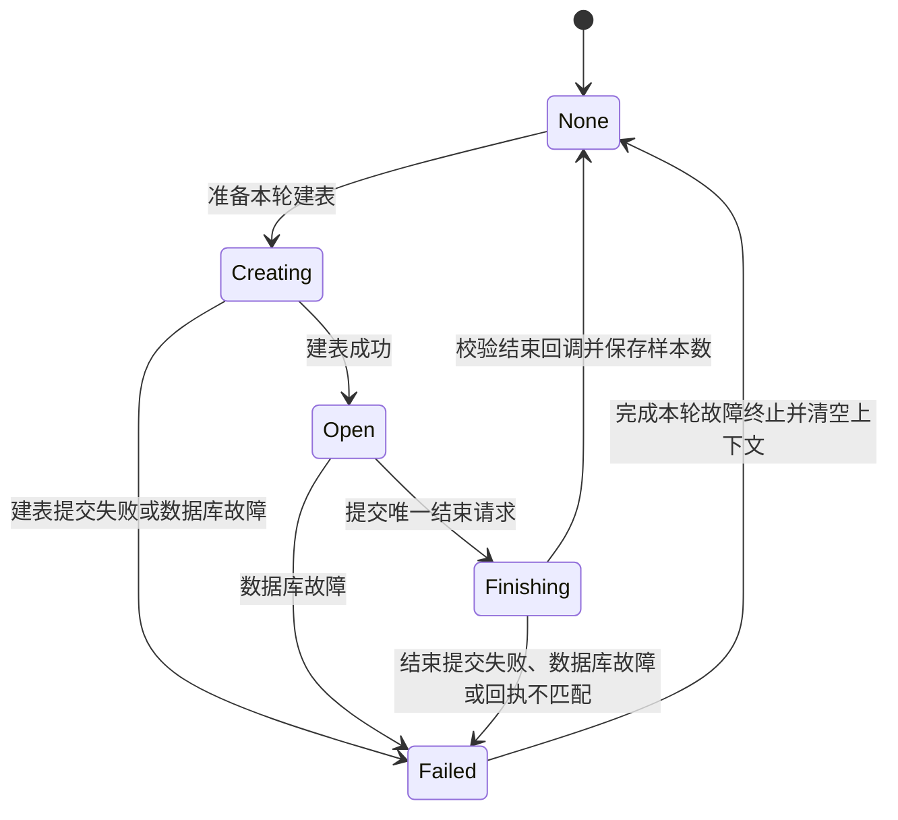

# 实验表重复收尾及启动失败时的终止路径重入

## 现象与证据边界

用户反馈启动测试失败，提示“没有可结束的 PostgreSQL 实验数据表。”。预期是启动阶段发生错误后，停止采集和运动，将已创建的实验表结束一次，再保存终止结果。实际代码允许不同收尾入口对同一张表重复提交结束请求，第二次请求会把数据库服务置为故障。

本记录基于修复前提交 `2d6e64a` 的源码检查；目前没有本次故障的现场日志，因此下述时序是代码可以到达的路径，不能认定其中某一条就是用户当次运行的完整时间线。修复提交使用 annotated tag `fix-workflow-table-finalization-20261016` 标记。

关联源码：

- [流程服务](../../src/workflow/TestExecutionService.cpp)：启动、停止、故障、建表/结束回调和最终结果发布。
- [数据库服务](../../src/database/AcquisitionDatabaseService.cpp)：结束请求入队、工作线程活动表状态、致命错误锁存。
- [采集服务](../../src/acquisition/DataAcquisitionService.cpp)：`CheckingIdle` 阶段同步停止、`Idle/Fault` 状态和采集停止信号。
- [工作台](../../src/view/pages/WorkbenchPage.cpp)：启动失败提示和模态故障提示。

## 报错到底表示什么

数据库工作线程 `finishExperimentTable()` 检查的是内存中的 `currentTableName_`。它为空时调用 `reportFatal()`，产生上述提示；这不是一次查询 PostgreSQL 后发现物理表不存在。

正常结束只会读取当前表名与样本数，清空活动表上下文，再发出 `tableFinished`。它不删除实验数据表。

必须区分两类失败：

| 情况 | 发生位置 | 反馈方式 |
| --- | --- | --- |
| 服务未就绪，结束请求没有提交 | `AcquisitionDatabaseService::finishExperimentTable()` | 同步返回 `false` |
| 请求已经提交，但工作线程发现活动表为空 | `AcquisitionDatabaseWorker::finishExperimentTable()` | 异步 `databaseFailed`，服务 `ready_ = false` |

“没有可结束的表”属于第二类。服务方法返回 `true` 仅表示提交了异步请求，不表示表已经结束。

另外，如果此前这条错误已经使数据库服务失去就绪状态，机器和采集的前置条件随后恢复，再次点击启动时，`validateStartPrerequisites()` 会直接返回保存的 `databaseStatusMessage_`。这也会显示“启动测试失败”，而本次尚未创建实验表。不能只凭弹窗标题判断错误发生在本次启动还是上一次收尾。

## 修复前的问题

### 1. 两个入口可以重复结束同一张表

`handleCollectionStopped()` 与 `tryFinishPendingTerminalState(bool)` 都可以直接调用数据库结束接口。两处都依赖 `tableOpen_`，而该标志直到结束回调到达才置为 `false`，无法表达“结束请求已经发出，正在等待结果”。

启动失败的一条具体路径如下：

```text
移动到零位置 → 建表成功 → 开始采集握手（CheckingIdle）
  → 运动/机器状态等原因触发 failExecution(原始错误)
  → stopCollection()
      → CheckingIdle 下直接 finishCollection()
      → 同步发出 collectionStopped
      → handleCollectionStopped() 提交结束请求 A
  → 返回 failExecution()
  → tryFinishPendingTerminalState(true)
      → 采集已是 Idle，tableOpen_ 仍为 true
      → 再提交结束请求 B

数据库线程处理 A：清空 currentTableName_，发出成功回调
数据库线程处理 B：currentTableName_ 为空，报致命错误
```

另一条路径是采集进入 `Fault` 后已经提交了结束请求，在数据库成功回调到达前又收到运动命令失败或其他故障。附加故障再次进入终止推进函数，仍然看到 `tableOpen_ == true`，再次提交结束请求。

### 2. 清理失败重新进入故障入口，职责交叉

旧 `handleCollectionStopped()` 在结束请求返回 `false` 时调用 `failExecution(error, true)`，后者可能再次进入结束表逻辑。它通常不会无限递归，因为第二处结束提交失败会直接完成终止，异步数据库失败也会走 `databaseUsable=false` 分支；但存在无意义的重复尝试。

更重要的是，“记录原始故障”“发送停止请求”“请求结束表”“等待回调”“发布最终结果”互相交叉，传入的临时 `databaseUsable` 参数不能单独描述本轮数据库收尾已经失败的持久状态。

### 3. 尚未建表完成，被误判为没有表

建表入队后、建表回调到达前，旧 `tableOpen_` 仍为 `false`。这时故障收尾可能直接发布终止结果并清空测试上下文。随后建表成功回调到达，又进入过期结果清理路径，表生命周期已经脱离原测试上下文。

### 4. 同步回调和模态提示允许重入

`CheckingIdle` 下停止采集会同步发出停止回调，因此外层 `failExecution()` 还没发完停止请求，内层就可能推进终止。

旧 `failExecution()` 还在请求停止之前发出 `executionFailed`，工作台直接调用模态 `QMessageBox::warning()`。停止操作可能被对话框打断，嵌套事件处理又能接收其他回调。最终结果发布本身也通过信号调用其他模块，需要防止同一终止过程重复进入。

## 新写法与职责划分

实现只修改 `TestExecutionService.h/.cpp`，复用既有线程、信号和数据库接口。

### 显式记录表生命周期

以类内私有枚举 `ExperimentTableState` 替换 `tableOpen_`：

| 状态 | 含义 | 终止时的处理 |
| --- | --- | --- |
| `None` | 没有在途建表/结束请求或活动表 | 满足采集条件后完成终止 |
| `Creating` | 已进入建表流程，等待结果 | 保留测试上下文，等待建表结果 |
| `Open` | 当前表已创建 | 通过唯一入口提交结束请求 |
| `Finishing` | 结束请求已提交，等待结果 | 等待，禁止重复提交 |
| `Failed` | 本轮数据库路径失败 | 不重试结束表，执行故障终止 |



`Failed → None` 是测试上下文清理，不表示 PostgreSQL 服务已经恢复。后续启动仍须通过原有数据库就绪检查。流程层的附加普通故障不会把 `Failed` 改回可用状态。

### 收敛提交、停止和最终完成入口

| 函数 | 新职责 |
| --- | --- |
| `failExecution()` | 登记外部故障；首次终止时请求停止，附加故障只更新原因和失败状态；随后推进终止 |
| `recordExecutionFailure()` | 原因按发生顺序追加，升级最终状态为 Fault，锁存机器故障，首次故障安排界面通知；不发停止或结束表请求 |
| `requestExecutionStop()` | 共用的停止请求逻辑，按既有策略停止采集和运动；提交失败只登记错误 |
| `requestExperimentTableFinish()` | 唯一调用数据库结束接口的位置；仅 `Open` 可以提交，提交前先设为 `Finishing` |
| `tryFinishPendingTerminalState()` | 唯一决定终止过程继续等待还是最终完成的入口；不再接受临时 `databaseUsable` 参数 |
| `finishPendingTerminalState()` | 发布当前记录/整组最终结果、清理上下文、更新最终机器状态；只由统一推进函数调用 |

如果结束请求被同步拒绝，唯一提交入口先设为 `Failed`，再登记“实验表收尾失败”原因；原来没有终止过程时补发停止请求，已经处于终止过程时不重复发停止。该入口不回调 `failExecution()`，从而切断清理失败绕回故障入口的调用链。

建表/结束回调先检查当前等待状态；建表成功只接受 `Creating`，结束成功只接受 `Finishing`，并继续校验轮次和表名。已终止、已失败或不在对应等待状态的回调不重新开启表状态。

正常记录完成仍须同时满足控制器完成计数与数据库结束成功，才能进入下一条记录；新枚举的 `None` 不替代 `currentRecordDataFinished_`。

### 防止同步停止和结果发布重入

- `terminalStopRequestsInProgress_` 通过作用域保护维持：停止请求尚未全部返回时，终止推进入口只等待。采集同步停止回调返回后，由外层继续发运动停止请求，再统一推进。
- `finalizingExecution_` 保护最终结果发布，防止重复发布或清空上下文；此时发生的外部故障记录到日志并立即锁存机器故障，不重入修改已发布的结果快照。`completeExecution()` 只允许 Running 转 Idle，因此不会把该迟到故障清除。
- 首次 `executionFailed` 改为排队通知，避免工作台的模态提示直接中断故障处理调用栈。状态与故障原因仍立即登记。
- 数据库失效时保留原有降级策略：先完成必要停止请求的提交，再结束软件测试上下文，不等待不可达的数据库回调。这不代表物理运动已经停止，原有机器/运动复位前置检查仍生效。

## 原问题如何被阻断

### CheckingIdle 阶段发生故障

```text
failExecution(原始错误)
  → 进入停止请求保护区，登记 Fault
  → requestExecutionStop()
      → stopCollection() 同步发出 collectionStopped
      → tryFinishPendingTerminalState() 发现保护区仍在，只等待
      → 按原策略继续请求停止运动
  → 离开保护区
  → tryFinishPendingTerminalState()
      → Open 改为 Finishing，提交一次结束请求
  → 结束成功回调：Finishing 改为 None
  → tryFinishPendingTerminalState()
  → finishPendingTerminalState()，仅发布一次终止结果
```

### 等待结束结果时又发生故障

附加错误只追加原因，再调用统一推进函数。该函数看到 `Finishing` 就返回等待，不会提交第二次结束请求。若附加错误是数据库致命错误，则进入 `Failed` 并走降级终止，不再等待结束成功。

### 建表尚未完成时停止或故障

状态为 `Creating` 时保持上下文。建表成功后转为 `Open`，因为终止状态已经存在，所以不启动采集，而是推进唯一结束请求；建表失败则转为 `Failed`，完成故障终止。

### 结束请求同步被拒绝

直接登记 `Failed` 和收尾错误，交给统一推进入口完成终止；不通过 `failExecution(..., true)` 重新尝试提交。原始故障保留在 `terminalReason_` 前面，附加错误继续追加。

数据库工作线程“没有活动表却收到结束请求”的致命检查保留，用于暴露其他真正的调用错误，而不是把错误吞掉。

## 验证记录与待验证场景

2026-10-16 已完成：

- 基于现有调用点静态检查旧时序、新状态迁移、同步回调重入和附加错误路径。
- 确认流程服务实际调用数据库结束接口的位置只有 `requestExperimentTableFinish()` 一处。
- 确认 `finishPendingTerminalState()` 的调用均位于统一推进入口，`tableOpen_` 和带布尔参数的终止推进接口已移除。
- 使用已有 VS2022 x64、Qt 6.5.3 MSVC、Debug 配置编译成功：

  ```powershell
  cmake --build --preset vs2022-x64-debug --target EddyCurrentBench
  ```

本次未运行应用、测试程序或真实设备，尚不能宣称现场故障已复现并通过回归。运行验证需要按项目阶段约束另行确认。

建议优先在离线环境验证以下事件时序，再进行现场确认：

| 场景 | 应观察到的结果 |
| --- | --- |
| 建表成功，CheckingIdle 期间触发故障 | 停止请求完成提交后，结束表请求仅一次 |
| 采集 Fault、结束请求在途时连续触发运动失败 | 原始原因保留，追加故障，结束请求仍仅一次 |
| 建表在途时用户停止/故障 | 不提前清空上下文，建表成功后直接收尾，不启动采集 |
| 建表请求被拒绝或异步建表失败 | 不永久等待 Creating，按数据库失败完成终止 |
| 结束接口同步返回 false | 不回到外部故障入口重试；终止结果为 Fault |
| Finishing 时数据库异步失败 | 不等待成功回调，不将失败误记成正常完成 |
| 重复/迟到的结束回调 | 不重复发布记录或整组结果，不进入下一轮 |
| 正常多轮完成，计数和表回调分别先到 | 两个条件都满足才推进，正常链路保持完整 |
| 用户停止时采集同步结束 | 不在运动停止请求发出前完成软件终止 |
| 故障提示对话框保持打开 | 必要停止请求已提交，收尾仍由状态和回调推进 |

新增日志 `[流程层][实验表收尾] 提交结束请求` 包含 `executionId`、轮次和表名，可用于确认同一实验表是否只提交一次。后续现场定位应同时保存第一条原始故障及该日志，避免只记录最后的数据库错误。

本次没有加入数据库重连、收尾超时、跨进程会话标识或硬件停止重试机制；这些需要独立的故障恢复设计，不能以当前编译通过替代运行验证。
