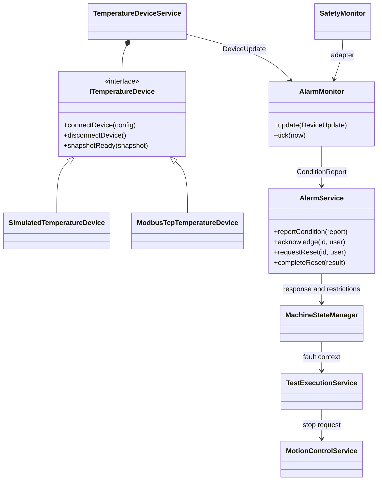
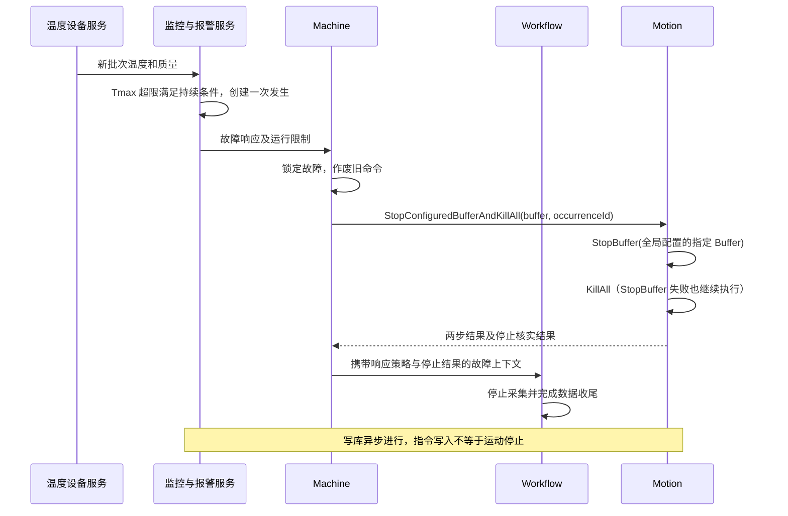

# 温度设备接入与统一报警最终设计

> 最新修订：报警模块以记录、展示、确认和事件通知为主。已删除运行许可、初始化就绪门禁、故障确认/复位门禁及监测失效自动停止；预警在可信恢复后直接关闭，故障在可信恢复且已确认后关闭，已恢复但未确认的故障仍在当前报警中。温度故障仍按既定策略停止指定 Buffer 并 KillAll，同时通知机器故障以收尾实验；原硬件安全回路保护保留。下文涉及运行许可、复位锁定的旧设计已被此修订取代。

2026-10-13 报警页修订：删除存储状态提示及状态筛选，保留等级和来源筛选。当前与历史是同一 `alarm_occurrences` 表按是否关闭划分的结果；首次触发即提交写库，确认、恢复、关闭按同一 `occurrenceId` 更新记录及时间，`alarm_events` 仅保留变更日志。数据库不可用时事件暂存既有重试队列。当前列为触发时间、等级、来源、报警内容、当前状态、恢复时间、关联实验；当前状态合并条件和确认信息，例如“已恢复，未确认”。历史列为触发时间、等级、来源、报警内容、关闭时间、关联实验，不显示状态列。修正载入记录时对已删除 `reset` 字段的校验。

2026-10-13 报警生命周期修订：阈值类先由监控器判定持续超限与持续恢复，信号类直接判断异常/正常；记录层统一按报警码和来源查找尚未恢复的一次报警。持续异常只保留同一记录，恢复后移出活动索引，再次异常创建新的 occurrenceId。旧故障即使尚未确认，也不接收新一轮采样；确认旧记录不会影响新记录。输入未知既不表示恢复，也不会撤销已记录的恢复。预警恢复即关闭；故障恢复且确认后关闭，确认与恢复先后顺序不限。

记录状态由恢复时间、确认信息和关闭时间得出。删除 AlarmEventType，统一采用 AlarmState：未确认未恢复、已确认未恢复、已恢复未确认、已关闭。UI 直接读取同一个状态；已关闭进入历史，历史仅展示关闭时间。恢复和确认均完成时直接发布已关闭快照，两个操作各自的时间仍保留，不再发布短暂中间状态。数据库 JSON 新增 state；原 event_type 列沿用编号 0（发生）、2（确认）、1（恢复）、5（关闭），旧事件日志保留原义，旧记录仍从时间及确认字段还原状态，无须迁移表结构。

删除 AlarmResponseStrategy、记录 condition 字段、报警层的停止结果状态和重试接口。旧 JSON 中多余的 strategy/condition 字段读入时忽略，无须删表。新报警发布 alarmRaised，应用连接层对 TEMP_FAULT 请求机器故障与停止指定 Buffer + KillAll；停止执行及反馈仍由运动模块处理，结果记录在运动日志中。硬件安全输入继续走原安全回路路径。

3 秒触发、10 秒恢复及 75℃恢复阈值用于新增离线检查用例；运行配置仍以 `src/globh.h` 为准，本次未修改运行阈值或延时。

本轮验证：既有 VS2022 x64 / Qt 6.5.3 / C++20 Debug 配置下，主程序编译并链接至 `build/vs2022-x64/Debug-alarm-lifecycle/`，离线目标 `TemperatureAlarmChecks` 构建成功。尚未执行离线用例、启动新程序或开展设备验证。

日期：2026-10-12
状态：设计已确认，2026-10-13 已完成实现与 Debug 编译；运行验证待单独确认。

本次四通道与弹窗精简：源文件编译通过，离线检查目标构建成功（未执行）；主程序链接因运行中的 exe 被占用而报 LNK1168，关闭现有程序后需重新构建。

用户补充确认：温度故障采用“停止全局配置指定的 Buffer，然后 Kill 所有运动”；新增全局配置头文件名称为 `globh.h`。以下设计已按此修订。

## 1. 设计结论

1. 第一版接入一个温度采集模块，用同一接口支持虚拟设备与真实设备。
   温度设备随软件启动自动连接并持续采集、报警监控，直到软件退出；实验开始、结束、停止和失败均不改变设备连接与采集生命周期。面板仍可由操作员手动连接/断开。
2. 真实通信只实现 **上位机 TCP Client + 设备 TCP Server + Modbus TCP**，读取 16 位有符号温度寄存器。设备端保持默认模式，接入成本最低。
3. 固定使用前四个通道 CH1～CH4，采集、显示和报警判断一致；无需配置通道。
4. 状态面板显示设备状态、四路温度和最高温度；弹窗仅提供连接、断开连接。
5. 报警分为 `Warning`（预警）、`Fault`（故障）。首批只有温度预警、温度故障、安全回路故障三个报警码。
6. 报警模块统一管理异常判断、发生记录、确认、恢复、复位锁定及报警响应要求。温度故障的明确响应是停止 `globh.h` 配置的 Buffer，再执行 Kill All；机器状态和设备动作继续由现有 Machine、Workflow、Motion 模块执行。
7. 用**每次新采集的已配置通道最大值**判断超温，保存历史峰值用于追溯；历史峰值不参与持续超温和恢复判断。

## 2. 当前代码与必须处理的接入点

| 已核实的当前实现 | 设计处理 |
| --- | --- |
| `DeviceStatusPanel` 已有 ACS 卡片点击、连接/断开弹窗及传感器显示 | 温度卡片沿用该交互；UI 不持有 Socket 或驱动 |
| `SafetyMonitor` 保存急停、四路光栅、门锁状态 | 复用现有安全采集，增加统一报警适配，不另建安全轮询 |
| `SafetyMonitor::stateFromSnapshot()` 当前只根据硬件急停汇总状态 | 第一版安全回路故障以现有硬件急停回路反馈为权威依据；光栅、门锁作为诊断明细保留，不擅自改变其极性和联锁语义 |
| `safetySnapshotChanged` 仅在状态或数值变化时发送 | 增加每次新观测的发布入口，或从 `AcsClient::safetyStatusSampled` 接入适配器；不能把“没有变化事件”当成断线 |
| `MachineStateManager` 已有 `Error/Idle/Running/Resetting` 和命令 epoch 校验 | 增加报警许可快照，复用机器状态机与队列命令失效机制 |
| `TestExecutionService::handleMachineStateChanged()` 进入故障后调用 `failExecution(..., false)`，假定安全硬件已物理停止 | 温度故障携带 `StopConfiguredBufferAndKillAll` 响应策略，明确执行 StopBuffer → KillAll |
| 控制器复位完成后直接调用 `MachineStateManager::completeReset()` | 增加最终报警条件、温度数据时效和待复位记录校验，防止仍超温时恢复空闲 |
| `AlarmPage` 当前为固定演示数据 | 改为订阅真实报警快照和历史查询，确认操作调用报警服务 |
| `AcquisitionBlock::motorTemperature` 来自 ACS 六通道高速矩阵 | 新温度模块作为独立低频来源，不直接覆盖现有 ACS 温度列或伪造成 1 kHz 数据 |
| 工程为 C++20、Qt 6.5.3；CMake 当前未链接 Qt Network | 增加 `Qt6::Network`；本机已有对应 Qt Network 包，不引入厂商 SDK 或新的第三方库 |

源码依据：`src/view/DeviceStatusPanel.*`、`src/safety/SafetyMonitor.*`、`src/machine/MachineStateManager.*`、`src/workflow/TestExecutionService.cpp`、`src/motion/AcsClient.cpp`、`src/view/pages/AlarmPage.cpp`、`CMakeLists.txt`。

## 3. 设备协议选型

依据用户提供的《ZQWL-DAM-热电偶温度采集网络版系列产品规格书 V1.0.0》：PDF 第 8～9 页为默认网络配置，第 17～18 页为 Modbus 和整数温度寄存器。

| 项目 | 第一版实现 |
| --- | --- |
| 网络角色 | 上位机主动连接，设备作为 TCP Server |
| 默认地址 | `192.168.1.253:1030`，可配置 |
| 协议 | Modbus TCP |
| 功能码 | `0x04`，读输入寄存器 |
| 温度地址 | 通道 1 对应 `0x0000`，通道 n 对应 `n - 1` |
| 数值转换 | 网络字节序转 `qint16`，再除以 `10.0`，保留负温度 |
| 断线标记 | `0xEC78`（有符号值 -5000）表示探头未接入或线路故障，不能显示成 -500 ℃ |
| 温度硬件更新率 | 手册标明 10 Hz/通道；软件轮询频率不等于硬件产生新测量的频率 |

例如 `[2, 3, 4]` 一次读取起始地址 `1`、数量 `3`。不连续配置如 `[1, 4]`，读取地址 `0～3` 后只保留通道 1、4，其余通道不显示、不参与报警。

手册明确列出了前八路温度地址，第一版可配置通道限定为 1～8，同时不得超过实际设备通道数。虽然系列介绍包含 16 路产品，通道 9～16 在本手册地址表中未得到确认，不能据此自行宣称支持。

使用 `QTcpSocket` 实现必要的只读 Modbus TCP 请求与响应。只实现温度读取，不实现参数写入、滤波设置、MQTT、UDP、浮点格式或 TCP Server 接入。配置保留网络角色与协议字段，第一版只接受 `tcp-client`、`modbus-tcp`；其他值明确报“暂不支持”，不显示可以使用的假选项。网口与 Wi-Fi 在可达的同一网络中使用同一 TCP 接口。

协议处理必须包含：MBAP 长度拆包、半包与粘包处理、事务号、协议号、站号、功能码、字节数及异常响应校验。每次仅保留一个未完成请求，超时后终止本轮并关闭会话；重连创建新会话并清空缓存，迟到响应不能成为新数据。连接成功只表示链路建立，收到首个可信响应后才表示采集就绪。

## 4. 精简设备接口与数据

逻辑上保留一个接口、两个实现和一个服务。两个具体驱动为私有实现，放在同一实现文件中；不建立通用设备插件框架。

```cpp
// 接口设计示意，不是本轮已实现的源代码。
class ITemperatureDevice : public QObject {
    Q_OBJECT
public:
    using QObject::QObject;
    virtual void connectDevice(const TemperatureConfiguration& config) = 0;
    virtual void disconnectDevice() = 0;
signals:
    void connectionChanged(TemperatureConnectionState state,
                           const QString& detail);
    void snapshotReady(const TemperatureSnapshot& snapshot);
};
```

| 对象/数据 | 职责 |
| --- | --- |
| `SimulatedTemperatureDevice` | 按同一配置生成已选通道；支持固定值、温度变化、探头无效和断线的验证场景 |
| `ModbusTcpTemperatureDevice` | 管理 Socket、请求、接收缓存、超时和温度解码 |
| `TemperatureDeviceService` | 配置读取/校验/保存、选择驱动、连接生命周期、缓存及对外发布 |
| `TemperatureChannelSample` | 实际通道号、℃ 值、`Good/Invalid/Stale` 质量及无效原因 |
| `TemperatureSnapshot` | 一次采集批次，含来源 ID、会话 ID、递增序号、UTC 观测时间、统一单调时基和已配置通道样本 |

`TemperatureSnapshot` 的通道列表始终与配置一致，无效通道也保留自己的质量，不能省略后冒充“所有通道正常”。禁止用 0 作为未读取、断线或无效温度的默认值。服务负责当前缓存和历史峰值，报警规则负责阈值判断，驱动不发布“超温故障”结论。

温度工作线程持有驱动、Socket 和轮询定时器。初始化时创建并注册跨线程值类型；连接、断开和切换驱动通过队列命令执行。退出时先停止轮询、终止请求、关闭 Socket，再释放对象并结束线程。

## 5. 配置及状态面板

温度模块不再读写 JSON。参数集中在 `src/globh.h`，修改后重新编译，在软件启动时读取一次；运行中不修改。

- 固定采集、显示 CH1～CH4，四路参与当前最大值和报警判断，不提供通道选择。
- `g_temperatureUseSimulator` 默认为 true，改为 false 使用真实设备。
- 网络默认 TCP Client + Modbus TCP，地址 192.168.1.253、端口 1030、站号 1；轮询 500 ms，请求超时 1000 ms，数据过期 2000 ms。
- 保留当前参数：预警触发 30℃、恢复 28℃；故障触发 35℃、恢复 32℃；各持续时间均为 1000 ms。
- 虚拟设备前四路默认 25、26、27、28℃。
- 状态面板固定显示四路及最大值，点击弹窗只有状态文字和“连接”“断开连接”两个操作，无参数表单、保存或通道选择。
- 服务仍校验网络、阈值及虚拟值。参数无效报告具体原因；运行、复位或运动未结束时拒绝主动断开。
- 软件启动即连接、持续监控，不随实验启停。所有四路数据有效且报警许可满足后才允许依赖温度的运行。
- 原 `temperature.json` 已退出构建、安装及运行读取；输出目录遗留文件不再生效。

## 6. 温度最大值及判断规则

定义本轮有效通道最大值：

`Tmax = max(本次新采集中，已配置且 Good 的通道温度)`。

每轮同时记录最大值来源通道及“配置通道是否全部有效”。所有通道无效时，最大值不存在，不发布 0 或沿用上一轮数值。

| 场景 | 阈值规则处理 |
| --- | --- |
| 全部配置通道有效 | 用本轮 Tmax 独立判断预警与故障 |
| 部分通道无效，但有效通道已经超限 | 有效超限证据仍可触发；运行许可同时受数据完整性限制 |
| 部分通道无效，其余未超限 | 无法证明整体正常，报告 Unknown，不恢复原报警 |
| 全部无效、通信断开或数据过期 | Unknown，重置尚未完成的持续计时，保留已发生报警和锁定 |
| 同一来源的旧会话、重复序号或迟到数据 | 丢弃，不刷新时效、不参与持续时间判断 |

预警、故障各自配置：触发温度、恢复温度、触发持续时间、恢复持续时间；故障触发线高于预警线，各恢复线低于各触发线。参数校验拒绝相互矛盾的配置，不指定未经工艺确认的实际阈值。

默认以 Tmax 持续超限为判断口径，最高值来源通道改变不会重启组级计时。用单调时钟计时，只在新观测到达时确认持续条件；定时检查仅将超时数据置未知，不能把旧缓存反复用于证明“持续超温”。超过允许观测间隔或超限条件中断，重新计时。

另外保存连接会话峰值和实验期间峰值及通道、时间，连接/实验边界分别初始化；故障触发时的最大值保存在首次现场，后续更新不覆盖首次现场。历史峰值只用于记录与显示，否则过去一次高温会导致以后永远无法恢复。

## 7. 报警模块边界与统一接口

未来其他机器故障也应统一进入报警模块。职责分配如下：

| 模块 | 负责 | 调用边界 |
| --- | --- | --- |
| 设备服务/适配器 | 发布温度、安全反馈、通信质量等事实 | `dataUpdated(DeviceUpdate)` |
| `AlarmMonitor` | 校验会话、顺序、质量，驱动规则，检查数据时效 | 唯一数据入口 `update(DeviceUpdate)` |
| 规则 | 阈值、状态等条件判断 | 输出 `ConditionReport` |
| `AlarmService` | 去重、发生记录、确认、恢复、复位请求及锁定 | `reportCondition/acknowledge/requestReset/completeReset` |
| `AlarmPolicy` | 将报警定义映射到通知、禁止启动、停止关联运动等要求 | 输出带类型的响应策略 |
| 现有 Machine/Workflow/Motion | 命令许可、机器状态、取消任务、停止运动及结果核实 | 执行报警响应并回报结果 |
| 存储/UI | 异步记录及展示 | 消费事件与快照，不能清除异常事实 |

不增加第二套 `MachineCoordinator` 或 `TaskExecutor`。它们在参考文档中的职责由当前 `MachineStateManager`、`TestExecutionService`、`MotionControlService` 承担。`AlarmPolicy` 第一版可为私有策略表，不必拆成独立服务。

保留参考构思中的 `DeviceUpdate → ConditionReport → AlarmEvent` 三个边界，但不要求现有 ACS 驱动改为继承统一设备基类。温度服务和安全适配器在发布边界转换数据。

温度消息用一个批次点位，例如 `PointId::TemperatureBatch`，其值为已注册元类型的 `TemperatureSnapshot`；安全点位为明确语义的安全回路状态。类型契约统一登记，非法类型标记 Invalid。这样可以完整传递同一次采集的所有通道，避免规则看到“通道 1 的新值 + 通道 2 的旧值”。新增设备通过新增点位或规则接入，不给监控器不断增加专用槽函数。

`DeviceUpdate` 保留稳定 sourceId、sessionId、每点递增 sequence、质量、观测时间和统一进程单调时基。连接管理先明确授权新会话，旧会话数据不能反向切换当前会话。监控器与报警生命周期状态在同一监控线程串行更新，数据库另设工作队列，UI 通过快照更新。



## 8. 首批三条报警及生命周期

| 报警码 | 等级 | 触发/恢复 | 响应 | 关闭要求 |
| --- | --- | --- | --- | --- |
| `TEMP_WARNING` | 预警 | Tmax 满足预警触发/恢复参数 | 提示并记录，允许当前测试继续 | 可信恢复后自动关闭，确认可选 |
| `TEMP_FAULT` | 故障 | Tmax 满足故障触发/恢复参数 | 禁止启动，停止全局配置指定的 Buffer，再 Kill 所有运动，终止后续步骤并收尾数据 | 恢复、确认、复位核实成功 |
| `SAFETY_CIRCUIT_FAULT` | 故障 | 已有硬件安全回路反馈触发/可信恢复 | 保留硬件安全处理路径，锁定机器并终止后续流程，核实停止结果 | 回路可信恢复、确认、复位核实成功 |

预警与故障是两条独立规则，预警已经发生不能阻止故障触发。UI 可以合并同一来源的摘要，但保留各自的报警码和记录。

数据质量 Unknown 不等于安全回路已物理触发，也不等于温度超过故障阈值。第一版通过“温度/安全监测不可用”的运行许可阻断表达这种情况，不伪造超温值，不额外新增用户尚未要求的报警码。以后可增加 `TEMPERATURE_SENSOR_INVALID`、`DEVICE_COMMUNICATION_LOST` 等明确故障。

报警记录区分三个标识：`AlarmKey(code, sourceId, operationId)` 表示条件，`occurrenceId` 表示一次发生，`eventId` 表示一次生命周期事件。字段包含等级、当前条件、首次发生时间、恢复时间、确认人和时间、待复位标记、状态修订号、关闭时间、首次现场、最新现场及可选实验名称。

状态约定：

- `Normal → Abnormal`：创建一次发生，只发送一次 Raised；持续异常更新现场，不重复创建或反复停止。
- `Abnormal → Unknown`：保持原记录和锁定，不记为恢复；重新获得异常证据时继续原发生。
- `Abnormal/Unknown → Normal`：只有可信恢复证据满足要求才记录 Recovered。
- 已恢复但尚未确认/复位时再次异常：创建新 occurrenceId，旧记录独立保留；处理旧记录不能解除新故障。
- 确认只表示操作员已知晓，不改变条件、机器状态或运动许可。
- 预警可以自动关闭；故障只有条件恢复且确认、复位要求均满足才关闭。

报警页显示当前“未关闭”记录，包括异常、未知、已恢复待确认/复位；关闭后进入历史。这是相对早期“恢复即进入历史”需求的调整，采用用户本次参考构思，避免待复位故障从当前处理列表消失。状态面板分别显示未恢复数量与待处理故障，确认后不能显示为正常。

报警存储沿用项目 Qt SQL/PostgreSQL 基础设施，独立报警发生表和事件表，不复制到实验日志；为存储工作线程创建独立连接。事件按 eventId 幂等写入，更新按修订号避免回退。写库与查询失败不阻塞报警响应；未写事件使用有界重试队列并显示存储异常，超出容量必须明确报告，不能声称无限离线可靠保存。重启先加载待处理故障并重新采集现场；无法核实记录或现场时保持运行受限，不承诺跨重启恰好一次执行。

## 9. 机器故障、停止与复位

机器故障需要同时维护两种信息：机器当前状态与全部有效阻断原因。不能只保存最后一条 reason 字符串；界面显示主要原因和其他原因数量，内部许可依据完整集合。

命令入口和实际队列执行前均检查：安全反馈可信、必需温度样本完整且新鲜、无当前故障条件、无待解除故障锁定。预警不阻断运行。新增/改变阻断条件及复位期间故障复发必须使旧 command epoch 失效。`beginExecution()` 的状态转换本身也检查许可，防止“外部检查通过后条件变化”的窗口。

温度故障的响应上下文至少包含 `occurrenceId`、来源、原因和响应策略。`MachineStateManager::enterFault(reason)` 可以兼容保留，但新的报警响应必须携带类型化上下文，不能根据中文 reason 猜是否需要停止。

响应策略采用枚举：预警为 `NotifyOnly`，温度故障为 `StopConfiguredBufferAndKillAll`，安全回路故障为 `HardwareStopFeedback`。每条报警定义绑定策略，Motion 层执行设备动作。

### 9.1 全局 Buffer 配置与执行顺序

实现时新增 `src/globh.h`，保存一个项目级 Buffer 配置变量，不在 UI、报警规则或设备驱动中重复硬编码 Buffer 号：

```cpp
// src/globh.h：已实现，启动前设置，监控运行中不修改。
#pragma once

inline int g_temperatureFaultStopBuffer = 2;
```

默认值 2 的依据是当前 `motorbuffer/all.prg` 的主运动程序实际位于 `#2`；其中“Buffer 10”的注释与导出段号不一致，不能按该注释选 10。最终真实控制器部署仍需核实。该全局配置在启动前确定，监控运行中不修改；发出停止请求时读取一次并保存到请求及日志，避免请求执行期间更换目标。

温度故障先更新运行限制、使后续命令失效，再安排保护动作，不等待实验收尾、弹窗或数据库。Motion 层增加独立的 `stopConfiguredBufferAndKillAll` 操作，在现有 ACS 工作线程中连续执行：

1. 记录 occurrenceId、策略和本次目标 Buffer；调用 `acsc_StopBuffer(handle, buffer, ACSC_SYNCHRONOUS)`。
2. 无论 StopBuffer 成功或失败，继续调用 `acsc_KillAll(handle, ACSC_SYNCHRONOUS)`，分别保留两步结果与错误；不能因第一步失败提前返回而漏掉 Kill All。
3. 上报两步调用结果，并核实指定 Buffer 已停止、所有运动已终结；完整成功才报告停止确认。
4. Workflow 停止采集、终止后续步骤并完成数据收尾；没有正在执行的实验时，也必须完成以上运动保护动作。

该策略始终覆盖自动运动、点动和回零，不能仅检查实验 executionId 或自动程序 `G_STATE`。停止类命令保留在故障态可用，按停止范围合并并发请求，确认前保持故障锁定。

现有普通测试停止仍通过 `G_ABORT_LATCH`；温度故障走上述明确策略。现有 `AcsClient::emergencyStop()` 已使用 `acsc_KillAll`，可复用该调用方式，但不能只调用它而遗漏停止指定 Buffer。

SDK 的 StopBuffer/KillAll 调用返回结果与停止状态核实分别记录，Motion 层给出 `Pending/Confirmed/Failed/TimedOut` 结果。停止核实超时由配置明确给出；失败/超时保留原故障和响应失败明细，不静默重试、不自动恢复运行。第一版仍保持三个主报警码；独立执行失败报警码可作为下一阶段扩展。

安全回路硬件保护继续独立执行，不通过上位机报警或数据库排队后才动作。软件核实其结果并结束关联流程。需要超出上位机通信与调度能力的保护响应时，应由对应下位保护承担。



### 9.2 复位

复位采用现有机器复位入口与 occurrenceId 关联。复位前要求：异常已可信恢复、需要确认的记录已确认、所有必需观测新鲜完整、运动终结已核实、实验收尾结束。控制器复位完成之后再次检查上述条件，并校验请求 ID、发生 ID 及状态修订号；任一状态变化、故障再次出现或旧反馈迟到，都不能释放锁定。只有本轮有效的完整复位结果才允许 `Resetting → Idle`；关闭报警不自动启动实验。

现有复位重新启动 Buffer 1、2、3，包含默认停止目标 2。若全局配置改为其他 Buffer，必须同步核实复位流程能恢复该程序的正常待命状态；恢复程序待命不代表自动重新启动实验。报警关闭本身不调用 RunBuffer。

## 10. 后续扩展与落地文件

首版只需要阈值规则和状态规则。规则接口预留 `onData()`、`onTick()`；动作超时确有需求时再添加 `beginOperation()/finishOperation()`，按唯一 operationId 管理，不预先实现整套任务框架。

| 后续故障 | 接入方式 |
| --- | --- |
| 驱动器故障 | 状态适配器发布故障码，增加状态规则、定义及响应策略 |
| 温度探头/通信故障 | 质量或通信证据，增加对应故障定义/看门狗规则 |
| 电机到位超时 | 注册本次动作 ID 与截止时间，增加超时规则 |
| 电流超限 | 明确数据是瞬时值、绝对值还是 RMS 后配置阈值规则 |

第一版按维护单元组织：

- `src/globh.h`：全局指定停止 Buffer 配置，默认按当前导出主运动段设置为 2。
- `src/temperature/TemperatureTypes.h`：配置、连接状态、通道样本、批次类型。
- `src/temperature/TemperatureDeviceService.h/.cpp`：接口、服务、两个私有驱动及启动参数校验。
- `src/alarm/AlarmTypes.h`：统一设备输入、条件、报警、事件、响应和复位契约。
- `src/alarm/AlarmMonitor.h/.cpp`：监控及私有阈值/状态规则。
- `src/alarm/AlarmService.h/.cpp`：生命周期、私有策略表和存储工作对象。
- 修改已有 `DeviceStatusPanel`、`AlarmPage`、Machine、Workflow、Motion 的必要接入点，在 `main.cpp` 装配；调整 CMake 的 Network 链接和配置部署。

温度读数需要记录时，按实际采样时间保存选中通道和当前最大值；实验峰值可进入实验附加结果。现有 ACS 原始温度列继续明确其来源，不能静默替换为重复插值的网络温度。

## 11. 实现后验证范围

阶段一：用户确认设计后，编写设备、配置、面板、首批三条报警及机器响应接入，并使用现有 VS2022 x64 / Qt 6.5.3 / C++20 配置编译；不切换编译器、SDK 或第三方布局。

阶段二：另行确认测试范围后，执行虚拟设备和本地协议模拟验证，最后进行真实设备只读联调。应覆盖：

1. 固定 CH1～CH4 的采集、显示、最大值来源一致，遗留 JSON 不影响运行。
2. 负温度与 `0xEC78` 解码正确；无效、断线、过期不显示 0，不错误恢复。
3. 半包、粘包、异常功能码、事务不匹配、超时及重连旧包不会成为可信样本。
4. 持续超限只产生一次发生，短暂超限不触发；预警和故障独立；回差与恢复延时有效。
5. 部分无效情况下仍识别已知高温，但不能用其余低温证明整体恢复；历史峰值不阻止当前恢复。
6. 弹窗仅有连接与断开，运行中服务拒绝主动断开；意外断线更新数据质量和运行限制。
7. 温度故障按全局 Buffer 配置执行 StopBuffer → KillAll；StopBuffer 失败仍执行 KillAll；两步结果和最终状态分别核实，覆盖自动实验、点动、回零及无活动实验的上下文。
8. 复位期间故障复发、反馈迟到、旧发生被确认、多个故障并存，都不能误解除新的限制。
9. 数据库失败不延迟停止请求；报警与实验日志职责分开；UI 不再显示固定演示“正常”。
10. 退出与重启正确释放设备线程、恢复待处理故障，并重新核实现场后才允许运行。

## 12. 实现交付说明（2026-10-13）

- 已实现设备服务、虚拟驱动、只读 Modbus TCP 驱动、固定四通道面板及连接/断开窗口。
- `src/globh.h` 集中定义温度参数，默认虚拟设备、固定前四路，预警 30/28℃、故障 35/32℃，持续时间均为 1000 ms。
- 生命周期与实验流程分开：仅应用初始化/退出及操作员手动连接/断开控制设备。`beginExperimentRecording()`、`finishExperimentRecording()` 只划分实验峰值统计和保存区间，不启动/停止轮询、不关闭 Socket、不重置报警状态。
- 第一版真实通信仅支持 TCP Client + Modbus TCP，采用整数温度格式和 `0x04`。本项目固定读取 CH1～CH4。
- 已实现阈值延时/回差、三条报警、确认、恢复、复位锁定、统一数据接口及会话/序号/时效校验。
- `AlarmService::registerDefinition()` 与 `reportCondition()` 支持后续故障注册和上报，生命周期不再限制为三个硬编码分支。
- 温度 JSON 不再部署或读取；Qt Network 运行库随主程序复制。
- `src/globh.h` 提供目标 Buffer（默认 2）和停止核实超时（默认 5000 ms）；故障保护在 ACS 工作线程顺序执行 StopBuffer、KillAll，并核实指定程序与全部轴的状态。StopBuffer 失败仍调用 KillAll。
- 必需监测失效时，正在运动的设备也会请求上述停止策略，形成监测失效运行限制，不伪造数值超温报警。停止失败后可由操作员明确重试；确认报警不重试物理动作。
- 新增独立 PostgreSQL 表 `alarm_occurrences`、`alarm_events`、`temperature_experiment_peaks`，在应用实际启动时由存储工作线程按既有数据库 schema 创建。首次历史恢复完成前阻止运行；之后写库失败在 UI 显示并进入有界重试队列，不延迟保护请求，也不单独伪造温度故障。
- 页面载入全部待处理报警和最近 1000 条已关闭历史；“今日发生”明确标注为已载入记录的计数，当前不提供跨全部历史的分页和导出。
- 每条实际重复实验分别保存网络温度峰值、通道、观测时间和完整/不完整扫描次数，并标明虚拟/真实来源。现有 ACS 高速温度列及导出含义保持清晰，网络温度不伪造成高速采样。
- 新增 `TemperatureAlarmChecks` 独立离线检查目标，覆盖延时、独立预警/故障、部分通道无效、负温度、重复/旧会话数据及过期缓存；阶段一只编译，不执行。

验证边界：已静态核对代码与设备规格，并使用现有 VS2022 x64 / Qt 6.5.3 / C++20 配置编译主程序和离线检查目标。尚未执行测试程序、上位机、ACS 模拟器、数据库迁移或真实设备连接，真实停止效果与网络联调仍需阶段二验证。
